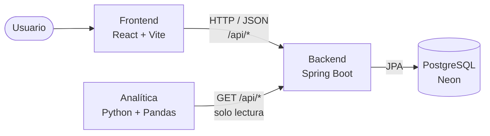

# PetMind · Frontend

PetMind conecta personas, animales en adopción y fundaciones de protección animal en Colombia. Este repositorio es la **interfaz web**: una SPA hecha con React, Vite y React Router que cubre las 42 pantallas de los mockups (público, acceso, adopción, donaciones, fundaciones, historias, reportes, panel de la persona y panel de la fundación).

## PetMind: los 3 repositorios

| Repositorio | Rol | Habla con |
|---|---|---|
| **frontend-petmind** (este) | Interfaz. Muestra datos, captura formularios y da retroalimentación al usuario. | Backend, por HTTP/JSON |
| [backend-pet-mind](https://github.com/ciroescuderobrayan-SDJ/backend-pet-mind) | API REST (Spring Boot). Reglas de negocio, validaciones y persistencia en PostgreSQL. | PostgreSQL (Neon) |
| [petmind-analitica](https://github.com/ciroescuderobrayan-SDJ/petmind-analitica) | Extracción, limpieza y análisis de datos (Python + Pandas). | Backend, solo lectura |



**El frontend no es un monolito.** Su trabajo es mostrar y capturar. Las reglas de negocio (quién puede iniciar sesión, cuánto lleva recaudado una campaña, cuándo una mascota pasa a "Adoptada") las decide el backend.

## Estado actual

Hoy el frontend funciona **sin backend**, como demostración:

- Los datos de prueba están en `src/data/`.
- Los contextos (`src/context/`) guardan todo en `localStorage` con claves `petmind.v1.*`.
- El inicio de sesión, los pagos, los correos y la asignación de reportes son simulados en el navegador.

Esto cumple el Momento 2 (SPA navegable con estado global y CRUD simulado). El siguiente paso es reemplazar esos datos locales por llamadas a la API del backend (ver [Conexión con el backend](#conexión-con-el-backend)).

## Tecnologías

| Tecnología | Uso |
|---|---|
| React 19 | Componentes e interfaz |
| Vite | Servidor de desarrollo y compilación |
| React Router DOM 7 | Navegación sin recargar la página |
| Context API | Estado global por dominio |
| CSS Modules | Estilos por componente, con variables en `styles/global.css` y modo oscuro |
| ESLint | Revisión de código |

## Estructura

```text
src/
├── App.jsx, main.jsx      Punto de entrada y proveedores
├── routes/                Rutas públicas y privadas (RequireAuth)
├── layouts/               MainLayout, AuthLayout, CheckoutLayout, DashboardLayout
├── views/                 Pantallas por sección (acceso, adopcion, donaciones, fundaciones,
│                          historias, institucional, cuenta, fundacion, admin)
├── components/            Piezas reutilizables (ui, cards, forms, layout, home)
├── context/               Estado global: Auth, Pets, Adoptions, Campaigns, Donations,
│                          Favorites, Foundations, Reports, Stories, AdminLog, Theme, Toast
├── data/                  Datos de prueba de la demostración
├── hooks/                 usePersistentState, useCountdown, useLogout
├── utils/                 Formatos, fechas, validaciones de formularios
└── styles/global.css      Variables de color, tipografía y clases base
```

Documentos de apoyo en la raíz: `PLAN-DE-TRABAJO.md`, `CONTEXTO-Y-DECISIONES.md`, `COMPONENTES-PROYECTO.md`.

## Requisitos

- Node.js 20.19+ o 22.12+.
- npm (incluido con Node.js).

## Iniciar el proyecto

```bash
npm install
npm run dev
```

Vite muestra la dirección local en la terminal (por defecto `http://localhost:5173`). Para usar otro puerto:

```bash
npm run dev -- --port 5199
```

## Verificaciones

```bash
npm run lint
npm run build
```

## Prueba del flujo completo (Playwright)

`e2e/flujo-adopcion.spec.js` recorre el flujo de adopción con datos reales del backend. Cada actor usa su propio navegador aislado, así que lo que uno ve del otro pasó por la API:

1. Una persona crea su cuenta (`POST /api/usuarios`), la verifica, cierra sesión y vuelve a entrar (`POST /api/auth/login`).
2. Busca una mascota, abre su perfil y envía la solicitud de adopción (`POST /api/solicitudes-adopcion`).
3. La fundación de la mascota entra a `/fundacion/solicitudes`, pasa la solicitud a revisión y la aprueba o la rechaza (`PATCH /api/solicitudes-adopcion/{id}/estado`).
4. La persona ve la respuesta en el seguimiento; si se aprobó, la mascota ya no sale en Adoptar.
5. El administrador ve la cuenta nueva en `/admin/usuarios` y las estadísticas en `/admin/estadisticas`.

```bash
npm run e2e:demo     # con el navegador visible, a ritmo de presentación
npm run e2e          # sin ventana
npm run e2e:reporte  # reporte con los pasos, capturas, videos y trazas
```

Las cuentas de las fundaciones y del administrador se leen de `e2e/cuentas.local.json`, que no se sube a Git (plantilla: `e2e/cuentas.example.json`). Opciones por variables de entorno: `E2E_BASE_URL` (por defecto el sitio publicado; con `http://localhost:5173` levanta Vite), `E2E_DECISION` (`aprobar` o `rechazar`), `E2E_FUNDACION`, `E2E_MASCOTA`, `E2E_PAUSA` y `E2E_TECLEO` (ritmo con el navegador visible: 2200 ms entre pasos y 70 ms entre teclas) y `E2E_CERRAR_AL_FINAL`.

Con `npm run e2e:demo`, al terminar el recorrido las ventanas de los tres actores quedan abiertas para seguir mostrando el sitio a mano; la prueba termina cuando se cierran todas (o con `Ctrl+C`). La persona creada se anota en `CUENTAS-DEMO.md` antes de esa espera. Con `E2E_CERRAR_AL_FINAL=1` se cierran solas, como antes.

Cada corrida crea una persona y una solicitud en el backend de producción. Con `aprobar`, la mascota queda `ADOPTADO`, así que la prueba escoge sola la siguiente mascota disponible (prefiere las que no tienen solicitudes abiertas de otras personas, porque aprobar cierra esas solicitudes).

## Cuentas de demostración

La contraseña de las cuentas precargadas es `petmind123`. Es anterior a la regla de contraseñas (mínimo 8 caracteres, una mayúscula y un carácter especial), que se exige al crear una cuenta o cambiar la contraseña; para iniciar sesión con las cuentas de demostración no se aplica.

| Tipo | Correo |
| --- | --- |
| Persona | `brayan.ciro@correo.com` |
| Fundación | `huellitas@correo.com` |
| Fundación en revisión | `huellasdelcaribe@correo.com` |
| Administrador | `admin@petmind.co` |

## Panel de administración

Las cuentas de tipo `admin` (equipo PetMind) entran a `/admin`. No se pueden crear desde el registro.

| Sección | Ruta | Qué hace |
| --- | --- | --- |
| Resumen | `/admin` | Cifras de la plataforma, colas de trabajo y bitácora de decisiones |
| Fundaciones | `/admin/fundaciones` y `/admin/fundaciones/:id` | Verificar, rechazar (con motivo), suspender y reactivar. Solo las verificadas salen en el directorio |
| Usuarios | `/admin/usuarios` | Cuentas de la demostración local y las registradas en el backend (`GET /api/usuarios`). Suspender y reactivar las cuentas locales: una cuenta suspendida no puede iniciar sesión |
| Mascotas | `/admin/mascotas` | Las del servidor: agregar una a nombre de una fundación del backend (`/admin/mascotas/nueva`) o corregirla. Las de demostración: retirarlas del sitio o restaurarlas |
| Campañas | `/admin/campanas` | Las del servidor: crear una a nombre de una fundación del backend (`/admin/campanas/nueva`). Las de demostración: aprobar o rechazar las nuevas; retirar o finalizar las activas |
| Historias | `/admin/historias` | Retirar o restaurar historias |
| Reportes | `/admin/reportes` | Notificar un caso a otra fundación, marcarlo resuelto, descartarlo o reabrirlo |
| Donaciones | `/admin/donaciones` | Libro de donaciones (solo lectura) con exportación a CSV |
| Estadísticas | `/admin/estadisticas` | Gráficas con los datos **reales** del backend que calcula la API de analítica en Python |

**Estadísticas** es la única sección del panel que lee datos reales: `GET {VITE_API_URL}/analitica` (Spring Boot), que le pide el tablero a [petmind-analitica](https://github.com/ciroescuderobrayan-SDJ/petmind-analitica) y reenvía su JSON. El recorrido es `services/analiticaService.js` → `services/analiticaMapper.js` (deja cada colección como `{ label, value }` y los textos legibles) → `hooks/useAnalitica.js` → `views/admin/EstadisticasAdmin.jsx`. Como los servicios gratuitos de Render se apagan sin uso, el hook reintenta solo hasta 5 veces (cada 15 s) y mientras tanto conserva las gráficas anteriores. Las gráficas son barras hechas con HTML y CSS (`components/charts/BarChart.jsx`), sin librerías, y cada una tiene su vista de tabla.

Cómo afecta al resto del sitio:

- **Retirar** no cambia el estado propio de la publicación (Disponible, Activa…): la oculta del sitio público y la fundación la ve en su panel como "Retirada por PetMind" con el motivo. Ver `utils/moderation.js`.
- **Campañas nuevas** quedan "En revisión" y no reciben donaciones hasta que el administrador las aprueba.
- **Fundaciones**: la fundación ve en su panel si está en revisión, rechazada (con el motivo y un botón para pedir una nueva revisión) o suspendida.
- Todas las acciones están en `views/admin/useModeration.js` y quedan en la bitácora (`AdminLogContext`).

Además de Estadísticas y Usuarios, las secciones **Mascotas** y **Campañas** tienen arriba una tabla "En el servidor" con lo que publicaron las fundaciones del backend (lo que se ve en Adoptar y en Donar), y el administrador puede agregar mascotas y campañas a nombre de cualquiera de ellas con los mismos formularios del panel de la fundación. Lo que agrega queda en la bitácora. Lo demás del panel trabaja con los datos locales (`localStorage`). Si el navegador ya tenía datos guardados, las fundaciones y la campaña de prueba pendientes de revisión no aparecen hasta [restablecer los datos locales](#restablecer-los-datos-locales); la cuenta de administrador sí está siempre disponible.

## Panel de la fundación (cuentas del backend)

Los representantes de las fundaciones del backend entran a `/fundacion` y gestionan todo contra la API:

| Sección | Ruta | Qué hace |
| --- | --- | --- |
| Solicitudes | `/fundacion/solicitudes` | Revisar, pedir documentos, aprobar o no aprobar las solicitudes de adopción |
| Mis mascotas | `/fundacion/mascotas` | Publicar (`POST /api/mascotas`), editar (`PUT`), pausar o dejar en borrador. Las publicadas y disponibles salen en Adoptar |
| Campañas | `/fundacion/campanas` | Crear campañas de donación (`POST /api/campanas-donacion`) con sus gastos (`/api/gastos-campana`): la meta es la suma de los gastos. El backend las deja activas, así que salen en Donar de inmediato |

- **Fotos:** el backend guarda el enlace de cada imagen en `/api/archivos` (máximo 500 caracteres), así que los formularios piden un enlace `https://…` o una foto de la galería del sitio (`/img/fotos/…`); una imagen subida desde el equipo no cabe. La primera foto es la portada.
- **Campañas sin edición:** `PUT /api/campanas-donacion/{id}` deja el monto recaudado en cero, por eso el panel todavía no ofrece editar campañas.
- **Donar:** `/donar` muestra las campañas del backend junto a las de demostración (ids `api-<id>`). El pago sigue siendo simulado: lo donado a una campaña del backend se suma solo en ese navegador.

## Favoritos

El corazón de las tarjetas y del perfil de las mascotas funciona también con las mascotas del backend, y "Seguir" con las campañas del backend. Si la cuenta es del backend, el favorito se guarda en el servidor (`POST`/`DELETE /api/favoritos`): se ve desde cualquier equipo, aparece en `/cuenta/favoritos` y cuenta en la gráfica "Favoritos por especie" de las estadísticas. Las cuentas de demostración los siguen guardando en el navegador.

### Restablecer los datos locales

En la consola de las herramientas de desarrollador del navegador:

```js
Object.keys(localStorage).filter((key) => key.startsWith('petmind.v1.')).forEach((key) => localStorage.removeItem(key))
Object.keys(sessionStorage).filter((key) => key.startsWith('petmind.v1.')).forEach((key) => sessionStorage.removeItem(key))
location.reload()
```

También puedes borrar los datos del sitio desde la configuración del navegador. Al hacerlo se cierra la sesión de demostración.

## Conexión con el backend

### Cómo debe quedar

```text
Pantalla (views/) → Contexto (context/) → Servicio de API (api/) → Backend /api/*
```

1. **Una sola URL base** en una variable de entorno de Vite. Crear `.env.local` (no se sube a Git):

   ```properties
   VITE_API_URL=http://localhost:8080/api
   ```

2. **Una carpeta `src/api/`** con un archivo por recurso (`mascotas.js`, `campanas.js`...) que use `fetch` y `import.meta.env.VITE_API_URL`. Las pantallas nunca llaman a `fetch` directamente.
3. **Los contextos dejan de ser la fuente de verdad.** Siguen existiendo para compartir datos entre pantallas, pero cargan y guardan a través de `src/api/` en lugar de `localStorage`.
4. **Migrar un dominio a la vez**, empezando por el que ya tiene todo en el backend (mascotas), para que la demo nunca quede rota.

### Contextos y endpoints

| Contexto | Endpoint del backend | ¿Existe en el backend? |
|---|---|---|
| `PetsContext` | `/api/mascotas` | Sí |
| `FoundationsContext` | `/api/fundaciones` | Sí |
| `CampaignsContext` | `/api/campanas-donacion` | Sí |
| `DonationsContext` | `/api/donaciones` | Sí |
| `AdoptionsContext` | `/api/solicitudes-adopcion` | Sí |
| `FavoritesContext` | `/api/favoritos` | Sí |
| `AuthContext` (registro) | `POST /api/usuarios` | Sí |
| `AuthContext` (inicio de sesión) | `POST /api/auth/login` | **No**, falta crearlo |
| `ReportsContext` | `/api/reportes-animal` | **No**, el servicio existe pero falta el controlador |
| Historias (`data/stories.js`) | `/api/historias` | **No**, el servicio existe pero falta el controlador |

### Diferencias de datos a resolver

El frontend y el backend nombran los campos distinto. Hay que acordar un formato o traducirlo en `src/api/`:

| Frontend | Backend |
|---|---|
| `name`, `species: 'Perro'` | `nombre`, `especie: 'PERRO'` (enums en mayúscula) |
| `id: 'luna'` (texto) | `id: 1` (número) |
| `user.foundationId` | `usuario.fundacion` (objeto) |
| Estados en español con espacios (`'En proceso'`) | Enums (`EstadoAdopcion`: `DISPONIBLE`, `EN_PROCESO`, `ADOPTADO`, `EN_TRATAMIENTO`) |
| Estados `'Visita agendada'`, `'Pausado'`, `'Borrador'` | No existen en `EstadoAdopcion`; revisar si van en `EstadoPublicacion` o si hay que agregarlos |

### Lógica que debe pasar al backend

| Hoy en el frontend | Debe hacerlo el backend |
|---|---|
| Comparar la contraseña en `AuthProvider.jsx` | `POST /api/auth/login` |
| Sumar la donación al recaudo de la campaña | `DonacionService` |
| Cambiar el estado de la mascota al decidir una solicitud | `SolicitudAdopcionService` |
| Elegir a qué fundaciones llega un reporte | `ReporteFundacionService` |
| Contar mascotas y campañas por fundación | Consultas del repositorio |

Las validaciones de formularios (`utils/format.js`, `utils/adoption.js`, `utils/payment.js`) **se quedan** en el frontend: dan mensajes rápidos al usuario. El backend vuelve a validar todo antes de guardar.

## Equipo del proyecto integrador

- Brayan Ciro
- Santiago Varela
- Emanuel Gómez

---

Proyecto académico · PetMind · CESDE
