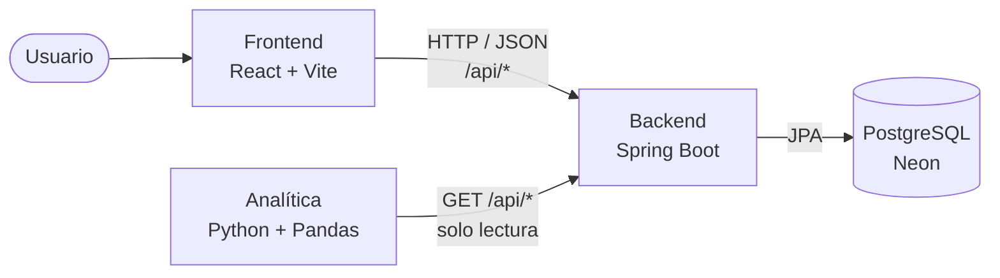

# PetMind · Frontend

PetMind conecta personas, animales en adopción y fundaciones de protección animal en Colombia. Este repositorio es la **interfaz web**: una SPA hecha con React, Vite y React Router que cubre las 42 pantallas de los mockups (público, acceso, adopción, donaciones, fundaciones, historias, reportes, panel de la persona y panel de la fundación).

## PetMind: los 3 repositorios

| Repositorio | Rol | Habla con |
|---|---|---|
| **frontend-petmind** (este) | Interfaz. Muestra datos, captura formularios y da retroalimentación al usuario. | Backend, por HTTP/JSON |
| [backend-pet-mind](https://github.com/ciroescuderobrayan-SDJ/backend-pet-mind) | API REST (Spring Boot). Reglas de negocio, validaciones y persistencia en PostgreSQL. | PostgreSQL (Neon) |
| [petmind-analitica](https://github.com/ciroescuderobrayan-SDJ/petmind-analitica) | Extracción, limpieza y análisis de datos (Python + Pandas). | Backend, solo lectura |



**El frontend no es un monolito.** Su trabajo es mostrar y capturar. Las reglas de negocio (quién puede iniciar sesión, cuánto lleva recaudado una campaña, cuándo una mascota pasa a "Adoptada") las decide el backend.

## Estado actual

Hoy el frontend funciona **sin backend**, como demostración:

- Los datos de prueba están en `src/data/`.
- Los contextos (`src/context/`) guardan todo en `localStorage` con claves `petmind.v1.*`.
- El inicio de sesión, los pagos, los correos y la asignación de reportes son simulados en el navegador.

Esto cumple el Momento 2 (SPA navegable con estado global y CRUD simulado). El siguiente paso es reemplazar esos datos locales por llamadas a la API del backend (ver [Conexión con el backend](#conexión-con-el-backend)).

## Tecnologías

| Tecnología | Uso |
|---|---|
| React 19 | Componentes e interfaz |
| Vite | Servidor de desarrollo y compilación |
| React Router DOM 7 | Navegación sin recargar la página |
| Context API | Estado global por dominio |
| CSS Modules | Estilos por componente, con variables en `styles/global.css` y modo oscuro |
| ESLint | Revisión de código |

## Estructura

```text
src/
├── App.jsx, main.jsx      Punto de entrada y proveedores
├── routes/                Rutas públicas y privadas (RequireAuth)
├── layouts/               MainLayout, AuthLayout, CheckoutLayout, DashboardLayout
├── views/                 Pantallas por sección (acceso, adopcion, donaciones, fundaciones,
│                          historias, institucional, cuenta, fundacion)
├── components/            Piezas reutilizables (ui, cards, forms, layout, home)
├── context/               Estado global: Auth, Pets, Adoptions, Campaigns, Donations,
│                          Favorites, Foundations, Reports, Theme, Toast
├── data/                  Datos de prueba de la demostración
├── hooks/                 usePersistentState, useCountdown, useLogout
├── utils/                 Formatos, fechas, validaciones de formularios
└── styles/global.css      Variables de color, tipografía y clases base
```

Documentos de apoyo en la raíz: `PLAN-DE-TRABAJO.md`, `CONTEXTO-Y-DECISIONES.md`, `COMPONENTES-PROYECTO.md`.

## Requisitos

- Node.js 20.19+ o 22.12+.
- npm (incluido con Node.js).

## Iniciar el proyecto

```bash
npm install
npm run dev
```

Vite muestra la dirección local en la terminal (por defecto `http://localhost:5173`). Para usar otro puerto:

```bash
npm run dev -- --port 5199
```

## Verificaciones

```bash
npm run lint
npm run build
```

## Cuentas de demostración

La contraseña de las cuentas precargadas es `petmind123`. Es anterior a la regla de contraseñas (mínimo 8 caracteres, una mayúscula y un carácter especial), que se exige al crear una cuenta o cambiar la contraseña; para iniciar sesión con las cuentas de demostración no se aplica.

| Tipo | Correo |
| --- | --- |
| Persona | `brayan.ciro@correo.com` |
| Fundación | `huellitas@correo.com` |

### Restablecer los datos locales

En la consola de las herramientas de desarrollador del navegador:

```js
Object.keys(localStorage).filter((key) => key.startsWith('petmind.v1.')).forEach((key) => localStorage.removeItem(key))
Object.keys(sessionStorage).filter((key) => key.startsWith('petmind.v1.')).forEach((key) => sessionStorage.removeItem(key))
location.reload()
```

También puedes borrar los datos del sitio desde la configuración del navegador. Al hacerlo se cierra la sesión de demostración.

## Conexión con el backend

### Cómo debe quedar

```text
Pantalla (views/) → Contexto (context/) → Servicio de API (api/) → Backend /api/*
```

1. **Una sola URL base** en una variable de entorno de Vite. Crear `.env.local` (no se sube a Git):

   ```properties
   VITE_API_URL=http://localhost:8080/api
   ```

2. **Una carpeta `src/api/`** con un archivo por recurso (`mascotas.js`, `campanas.js`...) que use `fetch` y `import.meta.env.VITE_API_URL`. Las pantallas nunca llaman a `fetch` directamente.
3. **Los contextos dejan de ser la fuente de verdad.** Siguen existiendo para compartir datos entre pantallas, pero cargan y guardan a través de `src/api/` en lugar de `localStorage`.
4. **Migrar un dominio a la vez**, empezando por el que ya tiene todo en el backend (mascotas), para que la demo nunca quede rota.

### Contextos y endpoints

| Contexto | Endpoint del backend | ¿Existe en el backend? |
|---|---|---|
| `PetsContext` | `/api/mascotas` | Sí |
| `FoundationsContext` | `/api/fundaciones` | Sí |
| `CampaignsContext` | `/api/campanas-donacion` | Sí |
| `DonationsContext` | `/api/donaciones` | Sí |
| `AdoptionsContext` | `/api/solicitudes-adopcion` | Sí |
| `FavoritesContext` | `/api/favoritos` | Sí |
| `AuthContext` (registro) | `POST /api/usuarios` | Sí |
| `AuthContext` (inicio de sesión) | `POST /api/auth/login` | **No**, falta crearlo |
| `ReportsContext` | `/api/reportes-animal` | **No**, el servicio existe pero falta el controlador |
| Historias (`data/stories.js`) | `/api/historias` | **No**, el servicio existe pero falta el controlador |

### Diferencias de datos a resolver

El frontend y el backend nombran los campos distinto. Hay que acordar un formato o traducirlo en `src/api/`:

| Frontend | Backend |
|---|---|
| `name`, `species: 'Perro'` | `nombre`, `especie: 'PERRO'` (enums en mayúscula) |
| `id: 'luna'` (texto) | `id: 1` (número) |
| `user.foundationId` | `usuario.fundacion` (objeto) |
| Estados en español con espacios (`'En proceso'`) | Enums (`EstadoAdopcion`: `DISPONIBLE`, `EN_PROCESO`, `ADOPTADO`, `EN_TRATAMIENTO`) |
| Estados `'Visita agendada'`, `'Pausado'`, `'Borrador'` | No existen en `EstadoAdopcion`; revisar si van en `EstadoPublicacion` o si hay que agregarlos |

### Lógica que debe pasar al backend

| Hoy en el frontend | Debe hacerlo el backend |
|---|---|
| Comparar la contraseña en `AuthProvider.jsx` | `POST /api/auth/login` |
| Sumar la donación al recaudo de la campaña | `DonacionService` |
| Cambiar el estado de la mascota al decidir una solicitud | `SolicitudAdopcionService` |
| Elegir a qué fundaciones llega un reporte | `ReporteFundacionService` |
| Contar mascotas y campañas por fundación | Consultas del repositorio |

Las validaciones de formularios (`utils/format.js`, `utils/adoption.js`, `utils/payment.js`) **se quedan** en el frontend: dan mensajes rápidos al usuario. El backend vuelve a validar todo antes de guardar.

## Equipo del proyecto integrador

- Brayan Ciro
- Santiago Varela
- Emanuel Gómez

---

Proyecto académico · PetMind · CESDE
